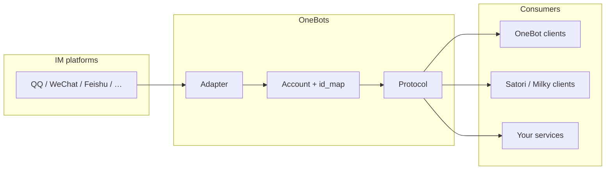

<div align="center">

# OneBots

**A multi-platform, multi-protocol IM bot gateway and framework (TypeScript / Node.js)**

_One `CommonEvent` abstraction, many platform adapters, many wire protocols (OneBot / Satori / Milky)._

[](https://github.com/lc-cn/onebots/actions/workflows/release.yml) [](https://github.com/lc-cn/onebots/blob/master/LICENSE) [](https://www.npmjs.com/package/onebots) [](https://nodejs.org) [](https://github.com/lc-cn/onebots/pkgs/container/onebots)

**[Docs](https://onebots.pages.dev)** · **[中文 README](./README.md)** · **[Issues](https://github.com/lc-cn/onebots/issues)**

</div>

---

## What problem does it solve?

You often want:

> **One process talks to many IM platforms, and exposes one or more standard protocols to plugins or your own backend**—without rewriting glue code per platform.

OneBots provides:

| Layer               | Role                                                                                                  |
| ------------------- | ----------------------------------------------------------------------------------------------------- |
| **Adapter**         | Maps each platform’s events & APIs to **`CommonEvent` + shared Adapter APIs**                         |
| **Protocol**        | Turns `CommonEvent` into **OneBot v11/v12, Satori, Milky** wire formats and handles inbound API calls |
| **`@onebots/core`** | Accounts, ID map (`createId` / `resolveId`), routing, protocol registry                               |
| **`onebots` app**   | Config, plugin loading, HTTP/WS gateway, optional **Web UI**                                          |

### Architecture (high level)



---

## Who it is / isn’t for

**Good fit if you:**

- Need **multiple IM platforms** and a **unified internal event model** before exporting to protocols
- Want **multiple protocols on the same account** (e.g. OneBot + Satori) for different ecosystems
- Prefer **Node.js ≥24 (`.node-version` recommended) / TypeScript** and a **self-hosted gateway**

**Maybe not if you:**

- Only target **one platform with one official SDK** (e.g. Discord.js only)—that can be simpler
- Rely heavily on **Python stacks** (e.g. NoneBot plugins)—stay there or bridge explicitly

---

## Comparison (neutral)

| Aspect                     | Raw platform SDKs | Other bot frameworks | **OneBots**                                       |
| -------------------------- | ----------------- | -------------------- | ------------------------------------------------- |
| Multi-platform abstraction | DIY               | Often yes            | `CommonEvent` + adapters                          |
| Multi-protocol export      | DIY               | Varies               | Same account, multiple protocols                  |
| Stack                      | Any               | Often Python/TS      | **TS / ESM / pnpm monorepo**                      |
| Ecosystem size             | —                 | Some larger          | **Infrastructure-style**; grows with contributors |

---

## Features (summary)

- **20+ adapters**: QQ official, ICQQ, WeChat OA, DingTalk, Feishu, WeCom, Telegram, Slack, Discord, Kook, Teams, Line, Email, WhatsApp, Zulip, Matrix, Google Chat, Facebook Messenger, Mock, …
- **Protocols**: OneBot v11/v12, Satori v1, Milky v1
- **Monorepo**: `pnpm workspace` (`packages/*`, `adapters/*`, `protocols/*`)
- **Optional Web UI**: `@onebots/web`
- **Client SDKs**: `imhelper` + `@imhelper/*`
- **Event flow**: `account.dispatch(commonEvent)` → each `protocol.dispatch`

---

## Quick start

### A) Docker (recommended)

For a **new, empty workspace**, persist both `/data` and an independent authority volume. Register offline first; keep the plan file on the host, outside `data/`:

```bash
umask 077
mkdir -p ./data
docker volume create onebots-authority
docker run --rm -v "$(pwd)/data:/data" \
  -v onebots-authority:/var/lib/onebots-authority \
  ghcr.io/lc-cn/onebots:master workspace plan --data-dir /data \
  --authority-dir /var/lib/onebots-authority/authority > onebots-plan.json

# Read the plan and its session-revocation impact; substitute its actual digest.
docker run --rm -i -v "$(pwd)/data:/data" \
  -v onebots-authority:/var/lib/onebots-authority \
  ghcr.io/lc-cn/onebots:master workspace register \
  --plan-file - --confirm '<plan.digest>' < onebots-plan.json

docker run -d --name onebots --restart unless-stopped -p 6727:6727 \
  -v "$(pwd)/data:/data" -v onebots-authority:/var/lib/onebots-authority \
  ghcr.io/lc-cn/onebots:master
docker exec --user 1000:1000 onebots \
  node /app/packages/onebots/lib/bin.js auth bootstrap --data-dir /data
```

Use the same image version with workspace admission support for every step. Without registration, the manager exposes a read-only maintenance page and cannot pair devices. Registration does not start the manager or gateway. Existing control v1 installations need the [offline upgrade procedure](https://onebots.pages.dev/guide/workspace-admission); earlier monolithic deployments cannot directly run strict-version `onebots migrate`.

Do not copy the authority with the business volume. This mechanism does not provide global exclusion for full-machine clones or cross-host HA. `HF_REPO_ID` automatic restore is disabled in this first release. See the **[Docker guide](https://onebots.pages.dev/guide/docker)** for deployment and storage boundaries.

### B) npm installation

On Linux/macOS with Node.js 24 or later, register a new empty workspace before starting the foreground manager:

```bash
npm install --global onebots
umask 077
mkdir -m 700 ./onebots-data ./onebots-authority
onebots workspace plan --data-dir ./onebots-data \
  --authority-dir ./onebots-authority > onebots-plan.json
# Read the plan; replace the placeholder with its actual digest.
onebots workspace register --plan-file onebots-plan.json --confirm '<plan.digest>'
onebots serve --data-dir ./onebots-data --authority-dir ./onebots-authority
```

Keep the foreground manager running. In another terminal, generate a device code and pair the browser:

```bash
onebots auth bootstrap --data-dir ./onebots-data
```

Use the Web **Install dependencies** page to select adapters, output protocols and framework integrations. OneBots installs required peers into an immutable runtime generation, verifies it, and activates it only after confirmation. The terminal uses the same control API:

```bash
onebots ui --data-dir ./onebots-data --setup
```

To host this registered workspace as an OS service, stop the foreground manager normally, then reuse its authority without registering again:

```bash
onebots install --data-dir ./onebots-data --authority-dir ./onebots-authority
onebots start
onebots status
```

A completely new service installation remains stopped until you explicitly confirm its registration plan. Use `--system` with lifecycle commands for a system-level service. On Windows, use the [elevated installer](https://onebots.pages.dev/en/guide/start); it prepares private ACLs, verifies the package capability and prints the offline registration steps. Installer sources are in `docs/src/public`. `doctor` diagnoses the manager and gateway; `update` handles runtime updates. The gateway can stop or fail while the management console remains available.

### C) From source

```bash
git clone https://github.com/lc-cn/onebots.git
cd onebots
pnpm install
pnpm build && pnpm test
```

**Requires Node.js ≥ 24.** Follow the [source quick start](https://onebots.pages.dev/en/guide/start) to register an empty development workspace and start it with the same authority directory.

---

## Production usage

Persist the management workspace, install extensions through the Web/TUI installation plan, then create and validate account and protocol configuration in the management console. Do not add packages directly to the active runtime or pass the removed `-r`, `-p` and `-c` flags. Full reference: **[documentation](https://onebots.pages.dev)**.

Downstream **imhelper** clients: **[Client SDK guide](https://onebots.pages.dev/guide/client-sdk)**.

---

## Repo layout

- `packages/core` — `@onebots/core`
- `packages/onebots` — CLI & gateway
- `packages/web` — Web admin
- `packages/imhelper` — client SDK core
- `adapters/*` — `@onebots/adapter-*`
- `protocols/*` — `@onebots/protocol-*` + `@imhelper/*` SDKs
- `docs/` — VitePress source

More: [packages/core/ARCHITECTURE.md](./packages/core/ARCHITECTURE.md)

---

## Contributing

```bash
pnpm build
pnpm test
pnpm changeset
```

[CONTRIBUTING.md](./CONTRIBUTING.md)

---

## License

[MIT](./LICENSE)

---

## Acknowledgements

- [icqqjs/icqq](https://github.com/icqqjs/icqq)
- [takayama-lily/node-onebot](https://github.com/takayama-lily/node-onebot)
- [zhinjs/kook-client](https://github.com/zhinjs/kook-client)
- [zhinjs/qq-official-bot](https://github.com/zhinjs/qq-official-bot)

---

<div align="center">

If OneBots helps you, consider a ⭐ on [GitHub](https://github.com/lc-cn/onebots).

Made with ❤️ by 凉菜 & contributors

</div>
