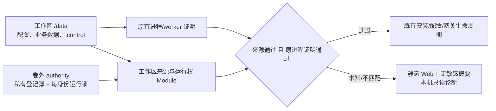

# 工作区来源与运行权方案（#278）

状态：方案经三轮技术审查通过；来源、认证、服务/native 与容器入口实现均已独立复审通过，本地验收通过，真实 Windows/systemd/launchd 尚待本分支 CI。维护者已确认第 9 节产品选择（含后续发现的 HF 恢复取舍）。基线为 master `21e3181c`（#277 已合并）。

流程：需求/契约调查 → 方案 → 子 agent 安全与生命周期审查 → 修订并通过技术审查 → 维护者确认产品决策 → 编码 → 子 agent 再审查 → 实际验收与 PR。审查通过不替代维护者对新默认、部署和认证行为的授权。

## 1. 需求与证据

目标是阻止正常备份复制出的 `/data` / `.control` 在没有明确操作的情况下，与原工作区同时获得同一逻辑实例的运行权，同时保留 #277 的同卷 Compose 正常关闭/重建能力。

已核实：

- `control/workspace.ts#acquireControlWorkspace` 持有本地 SQLite 写事务；只能互斥同一份锁文件，不支持 NFS/多主机共享目录。
- `service-migration-processes.ts` 的 v1 收据证明 PID/进程组、worker 及关闭状态，不证明目录不是副本。保留权限复制后，原件与副本各持自己的锁，均可认领所有权，已在两个一次性空账号工作区复现。
- `control/host.ts` 的 Windows native 分支把原有进程所有权设为可用，依据是原生 Job Object/管道；这不能证明工作区来源。
- `control/host-http.ts` 在当前所有权 gate 前处理认证；副本里的旧会话可能继续授权读取。新来源检查不能只加在网关启动处。
- 旧 `verification/manager-candidate-worker.ts` 创建 v1 seed 和认证样本，不传 authority，并要求样本 token 可读状态。严格拒绝 unbound 认证的新候选不能假装与此在线升级契约兼容。

隔离实测：当前 macOS + OrbStack 上，同一 bind mount 的 `.control` 在不同默认 hostname 的容器中 `dev/ino` 一致，目录复制后不同，目录重命名后相同；另一个审查 agent 独立确认 named volume 跨容器一致。未重启宿主、VM 或 Docker daemon，也未验证所有文件系统。

## 2. 证明范围与非目标

首期建议只保证：authority 在原宿主可靠本地存储且未随数据卷复制时，普通数据卷副本不会自行运行。运行必须同时满足来源证明、本地互斥及现有进程/worker 证明。

明确不保证：复制 authority、整机/VM/块设备克隆、恶意管理员编辑或删除证明、跨主机网络分区自动容灾、第三方平台账户的全局单登录。纯离线本地数据不能识别一份完全等价的整机副本。

不把本方案称为分布式 fencing。外部租约也不是捷径：旧进程暂停后恢复可能继续调用 IM SDK，不能假定所有平台校验 fencing token。本次不引入协调服务、租约期限、后台续租或自动故障转移。

首期不提供在线登记、强制接管、跨 authority 重绑、复制 `.control` 导入、authority 丢失后自动补建。目录物理身份变化时也不自动重绑。后续若需要移动卷/导入，必须另行设计源端撤销、旧实例重启及外部副作用处理。

## 3. 推荐结构

来源证明独立于进程存活证明，复用已有锁和生命周期，不把第二套进程管理器塞入收据代码。

### 3.1 卷外 authority

建议为可信启动配置显式提供 authority 根目录，禁止由业务 YAML、HTTP 请求、复制的 auth token 指定。

- 系统服务：复用 `service-files.ts` 按 user/system scope 解析的状态目录，在其私有子目录保存 authority，不能猜运行时 HOME。
- 前台：使用明确的用户状态目录；可由 CLI 显式指定。最终参数名与路径在产品确认后冻结，不使用多处 fallback。
- Docker：新增 `/data` 之外的命名持久卷，例如挂到 `/var/lib/onebots-authority`，由 Compose 配置明确复用。不能放在容器可写层、临时 HOME、匿名 volume 或 `/data` 内。
- authority 与 workspace 不得互为祖先或通过链接指向同一子树。既有 authority 权限/ACL 异常不自动修复；只允许安全初始化全新私有子目录，不递归 chown 既有数据。

登记簿保存 authorityId、workspaceId、物理目录身份、登记 revision 与操作记录。authorityId/随机 UUID 只是引用，不能单独证明来源；必须找到卷外已提交登记并匹配物理身份。权限、不可读、缺失、损坏、无登记、不匹配要保留不同结果，不能统一当作新安装。

不先加 HMAC/私钥：签名文件仍可复制；在本威胁模型中，私有卷外登记和物理身份是所需证据，额外签名不增加副本判别能力。

### 3.2 物理身份 provider

绑定 `.control` 目录，不绑定会被原子替换的配置文件/收据文件，也不只绑定字符串路径。

- POSIX：从无链接跟随的目录句柄读取 `dev/ino`，以 bigint 无损编码为字符串；核验路径与句柄仍指向同一对象，运行期保留必要句柄。拒绝链接、替换、不支持的存储及读失败。Linux FUSE magic 不能单独判定后端：本机 OrbStack bind 实测为 `virtiofs`，通过 kernel mountinfo 精确识别本地 virtiofs；未验收的 bucket / `fuse.*` 后端不因此获得支持。
- Windows：通过已有原生宿主读取受保护目录的 volume serial + 128-bit File ID，使用句柄/ACL 校验，不能用 POSIX mode 或把 Job Object 当作来源证明。离线检查必须能调用同一受信 native binary 的只读 helper，不依赖已停止的 SCM 服务/管道，也不另起守护进程。
- 这些标识只在相应文件系统/宿主上下文内有意义，不宣称跨主机全局唯一。物理身份变化进入维护状态；不得自动生成新 ID 或改登记。
- 宿主/VM 重启、重新挂载、文件系统更换后的无感恢复尚无通用保证。实现可对已验收 provider 保持正常恢复，但不能以短期容器探测承诺永久稳定。

authority 自身被复制属于非目标；文档与恢复流程必须明确这一点，不能把本地登记簿包装成云端全局权威。

### 3.3 两层互斥与锁顺序

1. 安全核验 workspace，取得现有卷内 `manager-lock.sqlite`。
2. 读取和验证绑定引用；取得 authority 下该 workspaceId 的独占运行锁。
3. 以短事务读取/校验登记簿；事务提交后不长期锁整个登记簿。
4. 来源证明与原 PID/PGID/worker 证明均通过，才开放敏感管理能力及业务副作用。
5. 持两把生命周期锁直到网关、安装/验证 worker 均确认退出、既有关闭记录完成；逆序释放。部分失败立即释放已经取得的锁，但不能据此宣告受管进程已退出。

所有登记操作沿用同一锁顺序，不得持全局 registry 事务等待 workspace 锁。不同 workspaceId 可以并行。副本即使获得自己的卷内锁，也不能抢占原件的卷外运行锁；原件不运行时，副本仍因目录身份不匹配被拒绝。

首次登记尚无 workspaceId 时，计划只提出一个固定的新 ID；执行先取得卷内锁，复核仍未绑定、没有既存未决登记，再取得该提议 ID 的卷外锁，才开启 registry 短事务。registry 对 workspaceId 与同 authority 下物理对象设唯一约束；另一个请求不能给同一对象另建身份。已存在 prepared 时只报告原请求，不自动接受新的 ID。全新 authority 也只允许 create-only 初始化；预期缺失却发现另一份 authority/登记时返回计划过期，不更换身份继续执行。

锁随 manager 死亡释放不等于 detached 网关退出。原有 active/unknown、PID/PGID、worker、下载凭据检查保持独立；不得因 authority 匹配便清空或重写旧 owner。

## 4. 持久化与状态

建议单独保存工作区绑定引用，不改写 v1 PID 收据来混合来源与存活事实。具体 schema 在编码前冻结，最少包括 authorityId、workspaceId、bindingRevision 及登记操作标识；登记簿为其提交状态提供权威。

来源检查返回明确的联合结果：

- `verified`：登记引用、物理身份、authority、锁均匹配。
- `unbound`：已有工作区/旧 v1，尚未登记。
- `authority-unavailable`：缺失、不可读或权限异常（内部保留可区分原因）。
- `binding-mismatch`：来源/物理身份/登记 revision 不一致，可能是副本。
- `registration-pending`：存在未对账的登记事务。
- `unsupported`：没有经过验收的 provider/部署来源。

只有 `verified` 可参与运行准入。其他结果保留读取证据和诊断，不推导为“旧进程已退出”或“未初始化所以可覆盖”。不为副本自动换 workspaceId。

### 登记事务

首期只支持离线、显式、首次登记；不存在任意 rebind 接口。

1. `plan` 只读预览：识别 v1/新安装、当前物理身份、authority 位置、旧收据 revision、worker/未决操作、认证影响及下次 start 的网关意图；不创建 authority 或改状态。
2. 用户在本机明确确认计划摘要。旧 manager/SCM/Compose 必须已停止；取得两层锁后复核全部前提。副本旧 token 不能授权登记。
3. 新安装只接受可证明的空业务根：根目录为空，或仅有 `.control` 且其中仅有经过常规文件、权限、单链接检查的精确管理锁/SQLite sidecar 白名单。不读取运行中锁数据库内容。仅 `.control` 缺失不算新安装；已有业务配置、账号数据、绑定、认证、收据或未知私有残片不能静默登记。
4. 对旧 POSIX v1，要求可信的正常关闭及现有进程/worker 证明；unknown、残留 foreign worker 或未决配置/安装均拒绝。不提供忽略检查的确认选项。Windows 旧版证明差异见下文，不要求其提供不存在的 POSIX closed 收据。
5. 在 registry 记录不可变请求 ID、计划摘要、预期旧状态摘要、目标引用及 `prepared` 意图，再原子写入工作区引用与确认后的认证状态，最后提交 registry 的 `committed` 状态。跨文件写入不是天然原子事务，必须有对账记录。
6. 崩溃后只在双锁内按同一请求 ID 对账。引用、认证或登记的任何中间状态均不得运行。完成结果可重复查询；不盲目重放登记、重建 authority 或发送外部请求。
7. 登记本身不 fork 网关、不安装、不登录账号、不发消息。完成后通过既有 start 恢复之前的 running/stopped 意图，计划必须预告这一点。

部分落盘、fsync/rename 失败、权限变化与撤销竞争都需要明确状态。若没有唯一证据证明完成，返回结果未知并保留现场，而非报告已失败并自动重试。

登记状态机冻结如下：

- 已确认计划固定 requestId、authority/workspace/物理身份、旧 receipt/binding/auth 的版本与摘要、目标 bindingRevision，以及认证 Module 的失效迁移 operationId。先持久提交 `prepared`；这一 durable 点之前不得改 workspace/auth。只保存必要的摘要/迁移引用，不复制认证明文到日志或计划输出。
- 每个目标只能从计划中确认的旧状态写到固定目标；已经是同一 requestId 的目标则视为该步完成。第三种字节/版本、不可读或无法证明身份的结果均为 unknown，不覆盖、不换 requestId、不另建身份。比较和写入必须在双方锁和单写者契约下进行，不宣称能与恶意管理员的任意文件写入实现 CAS。
- binding 引用与认证迁移分别完成原子替换、校验及 provider 的持久化屏障后，才可持久提交 `committed`。Windows 必须有经过实测的对应持久化契约，不能以 POSIX 目录 fsync 的假设代替。认证迁移由认证 Module 记录 binding 上下文/operationId，证明旧会话不可接受；不能只凭空列表或文件存在推断成功。
- `prepared` / 部分应用始终禁止运行；只读 inspect/start 不自动登记或重置认证。显式 resume 持同样双锁，重新验证同一物理对象、owner 与未决操作，只完成已确认的同一事务。任何未知保留现场；已完成状态只查询，不再次写入。
- `committed` 后认证可按正规配对/会话流程正常变化；之后验证其登记上下文，不永久要求文件等于最初目标摘要。不能通过恢复旧 auth 字节或回滚 binding 撤销已经应用的会话失效。不确定时保持维护状态。

全新目录的创建前提需单列：只读计划可记录可信空 workspace 的物理身份、已存在的纯锁目录身份或 `.control` 预期不存在，以及已确认的创建动作；执行取得卷内锁时才按既有锁机制创建 `.control`，随后固定其真实物理身份进入 prepared。此时不能把“prepared 前不得改 workspace/auth”误解成禁止已确认的锁目录初始化；禁止的是提前写 binding、认证或业务状态。prepared 前只遗留可核验锁工件时，可重新明确计划；任何 binding/auth/收据/未知私有残片均不适用此例外，也不能伪造成功或可续办证据。这个接缝已由安全子 agent 额外核对。

登记后 `.control` 已包含绑定/认证文件，不再满足当前进程 Module 的“加锁前目录不存在、加锁后只有锁文件”fresh 条件。新安装必须凭已提交登记中可核验的初始/从未运行证据，由原进程 Module 建立必要初始种子；其创建若发生在登记中，也必须作为同请求 prepared 中固定、可对账的目标。不得把 `verified` 当作 fresh、缺收据自动补种或免除原进程证明。旧安装仍按原收据核验，不走新安装分支。

### Windows 旧安装首登边界

Windows native v1 没有 POSIX closed 文件；其 status store 为内存，服务停止后管道消失也不是后代退出证明。现有受保护服务 metadata 和两次稳定 SCM 查询只能证明服务配置与 SCM stopped/PID=0，不能据此推导任意旧 worker 已退出。

离线计划要分别报告 SCM/受信 native Job 退出证据/worker 证据，不把管道不可达、查询错误或只有 stopped 合并为 quiet。已有受控 quiesce 的禁用服务等副作用不能藏进只读 plan。对当前旧 native 安装，若没有可离线核验的完整退出证据，首期登记返回 `unsupported` 并保留数据；不靠启动业务旧进程、杀历史 PID 或人工勾选“我已关闭”补证。支持这类旧安装的受控 stop/持久收据需要兼容阶段方案及单独确认，本稿不虚构现有 API。全新 Windows 安装和已经正规登记后的 native 生命周期仍属于实现/验收范围。

## 5. 认证与拒绝模式（需维护者确认）

建议绑定验证在加载/接受副本管理认证前执行，并覆盖 POSIX 与 Windows。来源不通过时：

- 可访问静态 Web 壳与不含路径、账号、会话、hostname 的原因概要，以及应用身份健康检查。
- 仅本机受 OS 权限保护的 CLI/诊断可查看登记细节。
- 不接受旧 token 读取配置、聊天、账号数据、日志或终端，也不能配对/登记、安装/激活、改配置或启动网关。
- 不删除、改权限或自动重置 auth.json 来换取可用性。Web 明确提示需本机登记，不伪装成密码错误。

建议首次显式登记使旧设备会话与未兑换码失效，并要求重新配对；这是计划和确认中明确展示的影响，不能自动发生。正常已登记工作区的容器重建保留会话，不因 hostname 改变重新配对。业务账号会话/配置不因管理认证登记而重写。

认证上下文需绑定稳定的登记身份/revision，不能绑定每次进程启动 ID。由认证 Module 拥有状态迁移与会话失效，不让来源 Module 直接删/拼 auth 文件。损坏、未知归属认证文件不视作不存在；首期拒绝强行登记。

### 拒绝态的最小启动/关闭路径

不能仅在完整 host 的 HTTP handler 加 guard。当前 `host.ts` 在所有权结果之后仍构造日志、聊天库、通知、generation、认证和 controller，并在关闭时写 stopped/closed；这些构造和关闭副作用早于/晚于请求路由。必须在公共初始化处先决定来源准入，再选择已有完整初始化或最小诊断初始化。

最小诊断初始化只持本次取得的锁/目录句柄、提供静态资源、应用身份健康检查和不含敏感信息的来源概要。不构造业务 writer、controller、auth（包括部署环境认证 bootstrap）、generation/configuration/installation store，不认领或修复进程收据，不开网关代理、WebSocket、终端或配对能力。Web、UDS、Windows RPC 使用同一显式只读白名单；`local=true` 不得绕过来源拒绝。未列出的请求统一拒绝。

最小路径关闭仅停止本次监听并释放本次锁/句柄，不写 manager stopped、process closed 或其他业务状态。详细诊断由本机 CLI 直接调用来源 Module 的只读 inspect/schema，不强行构造现有依赖完整运行态的 ControlDiagnostics。离线登记仍要求先停止这个诊断 manager，不能从其只读 transport 升级成登记操作。测试须比较拒绝启动/关闭前后受保护文件字节及进程创建记录，不只检查 HTTP 状态。

## 6. 旧版升级与恢复

这是目前最重要的兼容决策，不能用一个允许跳过身份检查的测试参数绕过。

### 建议首期：受控离线升级与一次性登记

- 旧版本的在线 candidate 验证不认识 authority，也要求 v2 认证样本不变；因此不宣称从 #277 直接在线无感升级到严格准入版本。
- 必须提供明确的部署更新指引：保留完整数据与旧程序 → 正常停止旧管理服务 → 使用新程序只读检查/预览 → 维护者显式登记 → 用既有 start 启动。Docker 在升级前增加独立 authority 挂载。
- 不通过旧验证器误判候选，也不让旧程序自动回写新绑定数据。若维护者要求保留完整在线升级体验，应改为两个版本交付：先只发布验证契约兼容能力，再启用严格准入；两个阶段不能混成一次“自动兼容”。
- 新 candidate 验证必须使用独占临时工作区和临时 authority，经正规新工作区登记后运行同一验证；不能读取或改生产 authority，不提供 skipOwnership。旧目标不支持来源契约时提前报告不兼容，不继续激活。
- `ManagerServiceSpec` 当前为固定字段 v1。新增 authority 来源需要明确的新版本契约及 v1 只读解析，贯穿 args/服务定义/候选/安装/升级/迁移/回退；不得只在 serve 中加环境 fallback。
- 新候选必须显式声明受支持的来源准入/认证上下文契约版本，由验证器在隔离环境实际验证；不按包 semver 猜能力。Windows 原生配置/状态协议也要声明相容版本，并能表达来源拒绝和 gateway 不可用，不伪造正常 stopped/running 状态；旧解析器不认识时明确拒绝，不能静默丢字段。

### 回退/恢复界限

- 首次登记前：保留旧程序与原字节，可按既有关闭证明恢复旧安装。
- 首次登记后：会话失效是已确认的外部可观察效果，不能因文件回退重新启用旧会话。不能自动启动不认识来源检查的旧程序读取已绑定数据；恢复由同契约程序对账完成，或明确停机处理。
- authority 丢失：维护模式；恢复匹配的原 authority 备份，不自动在新宿主建一个替代 authority。
- 物理身份变化/移动卷/复制卷：首期维护模式，不提供“确认一下就强行重绑”的捷径。手动转移业务配置前，目标必须先独立完成空工作区的新安装登记，源实例及其受管进程须已核实停止；不拷贝 `.control` 或 authority，不把已有业务目录当作 fresh 首登。此处不承诺完整归档导入、受控接管或全局 fencing。
- foreign worker、未决安装/配置、进程结果未知：继续使用原有诊断与人工核实，不迁移凭据、不对旧 PID 发终止信号。

## 7. 实施切分与职责

只有技术审查和产品决策均通过后开始：

1. 冻结授权范围、部署/升级/认证契约与 provider 失败策略；先补真实副本反例及 acceptance fixtures。
2. 新增来源准入 Module，内部负责 authority 登记簿、每身份运行锁、物理身份、事务对账；复用 `exclusive-file-lock.ts`。小 Interface 提供只读 inspect/plan、离线 register、持锁 acquire/release，不向调用方散落独立布尔开关。
3. 扩展可信服务契约与 Docker 挂载配置；Windows provider 放入已有原生宿主，不创建第二个守护进程。
4. 接入 `startControlHost` 公共初始化路径；来源准入与原进程证明取交集，Windows native 不能 bypass 新来源检查。拒绝状态在创建敏感写入者/接受旧认证之前生效。
5. 认证 Module 实现经确认的登记迁移；CLI 提供离线预览/明确执行/结果查询；Web 与 doctor 展示真实、最小的信息。
6. 更新候选验证、服务安装/迁移/升级/回退及文档、changeset。无业务协议/适配器重构。
7. 子 agent 审查完整实现和受影响调用链，修复发现后再验收、提交/推送 PR。不自动合并或部署。

## 8. 验收矩阵

| 场景 | 期望与证据 |
| --- | --- |
| 新安装 | 真正全新目录正规登记；登记后凭明确初始证据接入原进程 Module，不把 verified 当 fresh；已有配置但丢 `.control` 不自动自证 |
| v1 正常升级 | 只读计划、显式登记；登记前不启动，原配置/业务数据字节不变，管理会话变化符合确认 |
| 同卷 Compose down/up | 默认 hostname 改变、PID 1 重用，来源验证通过；running/stopped 意图和登记后的认证保持 |
| 同 authority 复制目录 | 原件运行与原件停止两种均拒绝副本；锁/目录身份条件分别反向验证 |
| 跨 authority 副本 | authorityId/登记不匹配，不自动创登记；旧会话不能读敏感数据或登记 |
| authority 缺失/无权/损坏 | 三类结果可区分；不补建、不改权限、不 fork、不重放安装 |
| 两个合法 workspace | 可并行，不被全局 registry 长事务误阻断 |
| 并发启动/登记 | 同身份只一方可进入，固定锁顺序，无死锁/锁文件替换 |
| 登记各持久化阶段崩溃 | prepared/ref/auth/commit 各点注入失败；中间态不运行，重复查询不产生新身份或复活旧会话 |
| manager 强退/残留 worker | 运行锁释放不等于进程已退出；unknown gate 与凭据保护不变 |
| 主机/VM 重启与重新挂载 | 分平台真实验证；身份变化进入明确维护状态，不把模拟重启当作实机保证 |
| Windows | 卷/File ID/ACL/Job/管道一起验收，无 native-mode 来源 bypass |
| 候选与回退 | 旧验证器的真实不兼容可复现；新验证器用隔离 authority；不自动降级到忽略绑定的程序 |
| 模型边界 | 完整 authority/整机克隆明确不保证，不以 chmod 失败或复制 ID 当防双开证明 |

单元/模拟只证明相应分支；必须有独立进程、真实 Docker 卷、Windows runner 和 OS service 的集成证据。尚未执行真实平台登录/消息，也不以本机文件实验冒充全球互斥。

## 9. 编码前需要维护者确认的产品决策

推荐组合：

1. **维护者已确认**：首期只防普通数据卷副本；不含 authority/整机克隆、跨机 HA、强制重绑/完整 `.control` 导入；物理身份变化允许停留维护状态，不承诺所有宿主重启无感。
2. **维护者已确认**：接受独立 authority 持久目录/第二个 Docker 挂载，以及有完整关闭证据的 POSIX v1 的一次性离线更新和明确登记；缺退出证明的旧 Windows native 安装首期不支持直接登记。本次采用离线方式，不采用兼容版本先行的分阶段方式。
3. **维护者已确认**：unbound/mismatch 时隔离旧认证的敏感读取；首次登记明确使旧管理会话/未兑换码失效、重新配对，正常已登记重建仍保持会话。
4. **维护者随后明确确认**：首期禁用 `HF_REPO_ID` 自动恢复，在任何下载/工作区或 authority 初始化/改数据前明确拒绝，保留独立归档工具，受控恢复后续补齐。原因是原“先恢复再登记”没有关闭证据，“先登记再恢复”又不符合旧工具的完全空目录契约；本次不以忽略 `.control` 或自动登记绕过。HF 存储 provider 仍未实机验收，本机双卷入口验证不替代该证明。

以上产品选择均经本次对话逐项确认。后续若改变这些行为，先修订并确认，不能以本次批准扩大范围。

## 10. 权威契约

- [Node 24 fs Stats](https://nodejs.org/docs/latest-v24.x/api/fs.html#statsino)：dev 为设备标识、ino 为文件系统 inode；不是全局永久身份。
- [Linux stat(2)](https://man7.org/linux/man-pages/man2/stat.2.html)：文件系统对象属性与失败语义。
- [Windows FILE_ID_INFO](https://learn.microsoft.com/en-us/windows/desktop/api/winbase/ns-winbase-file_id_info)：卷序号加文件 ID 用于同一台计算机上的文件识别。
- [Docker volumes](https://docs.docker.com/engine/storage/volumes/)：容器可写层随容器删除；持久卷独立于容器，匿名卷不会自动跨新容器复用。
- [SQLite file locking](https://www.sqlite.org/lockingv3.html)：现有本地文件事务锁的契约，不能替代不同副本之间的权威。
- [Linux virtiofs](https://docs.kernel.org/filesystems/virtiofs.html)、[proc mountinfo](https://man7.org/linux/man-pages/man5/proc_pid_mountinfo.5.html)：区分本地宿主/guest 文件共享与其他 FUSE 后端；不根据一个通用 magic 推定对象存储可靠性。

## 11. 审查记录

- 初审：安全与生命周期两名子 agent 均未放行；已据此增加证明范围、每身份卷外锁、Windows 公共准入、认证隔离、v1 升级真实不兼容、离线登记和回退界限。
- 第二轮：两名子 agent 均暂不放行；分别要求明确登记持久化状态机、拒绝态构造/关闭副作用、Windows 旧安装退出证明。
- 第三轮：安全与生命周期子 agent 均通过技术方案，无剩余设计阻塞；已补入新安装登记与原进程 fresh 判定的集成不变量。审查结论仅限当前首期范围。
- 维护者随后逐项确认第 9 节三组产品选择，允许进入实现。实现完成后仍须子 agent 代码审查和行为验收。
- 实现代码复审已根因修复：未知 authority 不补表自证、正常安装历史复用 owner 的真实只读契约、独立维护页、prepared 无引用时正确诊断、所有 helper 前清除部署秘密、验证 worker 完整集合，以及 legacy 续办旧证明摘要固定。来源/认证的独立审查已通过；相关旧反例均保留回归，不放宽断言。
- 入口复审另发现 `chown -R /data` 破坏拒绝现场，改为仅真实空卷交接目录、既有内容不自动修权，并验证 auth/account 的 uid/gid/mode/ctime 和字节。HF 原恢复成功路径不适用新登记契约，经维护者另行确认按第 4 项明确禁用，不能拿只有 marker 的验收宣称恢复成功。
- 最终实现复审通过，无剩余源码阻塞。主包回归 283 个文件通过，2,305 项通过、6 项平台相关跳过；42 个发布 tarball 的入口与生产边界检查通过，受影响包构建、原生宿主交叉编译及文档构建通过。
- 真实本地入口验收覆盖已安装 CLI/TUI、Chromium Web、跨入口竞争、Mock 五协议及管理程序升级/恢复；真实 Docker 验收覆盖双卷重建、期望状态与认证保持、强退拒绝、已有数据元数据保护，以及 HF 自动恢复提前拒绝和正常入口。没有登录真实 IM 账号，HF 云端存储 provider、Windows SCM/ACL、systemd、launchd 和完整主机重启仍须对应 CI 或部署验收，不能从本地结果外推。
